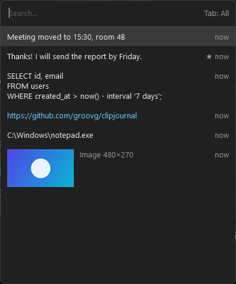

# clipjournal

[](https://github.com/groovg/clipjournal/actions/workflows/build.yml)

clipjournal is a small, fast clipboard history for Windows 10/11 that can replace Win+V. It ships as one exe of under 400 KB, with no installer and no runtime dependencies.



## Features

- **Records** text, links, images and copied files. Images are stored as PNG, with transparency when the source app provides it.
- **Keeps history across reboots**, unlike the built-in Win+V.
- **Expires items on your schedule**: `keep=7d`, a separate `keep_images`, and/or `max_items`. Pinned items never expire.
- **Search as you type**, with filters you switch with Tab: All, Pinned, Text, Links, Images, Files.
- **Any hotkey**, including taking over Win+V.
- **Pastes into the window you came from**, or only copies (Shift+Enter).
- **Skips secrets** that password managers mark as such, plus a per-app ignore list.
- **Fits into Windows**: follows the system dark or light theme, scales per monitor (DPI), opens at the text cursor, has rounded corners.
- **Stores history as plain files**: each entry is one file you can open, back up or sync. There is no database.
- **Portable mode**: drop a `config.ini` next to the exe.

## Install

**Scoop:**

```
scoop bucket add clipjournal https://github.com/groovg/clipjournal
scoop install clipjournal
```

**winget** (once Microsoft has approved the package):

```
winget install groovg.clipjournal
```

**Manually:** download `clipjournal.exe` from [Releases](https://github.com/groovg/clipjournal/releases/latest), put it somewhere permanent (for example `%LOCALAPPDATA%\Programs\clipjournal\`) and run it.

To launch clipjournal on login, open the tray icon menu and choose **Start with Windows**.

**SmartScreen and antivirus:** the exe isn't code-signed yet, so SmartScreen may show "Windows protected your PC". Click **More info**, then **Run anyway**. Some antivirus tools flag any program that both reads the clipboard and uses a keyboard hook. All the code is in [one file](clipjournal.cpp), so you can read it, or build the exe yourself.

**Tip:** turn off the built-in history (Settings → System → Clipboard), otherwise everything is recorded twice.

## Usage

| Key | Action |
|---|---|
| Win+V (configurable) | open or close the history |
| typing | search |
| ↑ ↓ PgUp PgDn | move the selection |
| Enter / click | paste into the previous window |
| Shift+Enter | copy only |
| Tab / Shift+Tab | switch the filter |
| Ctrl+P | pin or unpin |
| Shift+Del | delete the entry |
| Esc | close |

The tray icon menu has: Open history, Pause recording, Ignore next copy (for a one-off secret), Edit config, Reload config, Open data folder, Start with Windows, Clear history (keeps pinned), Exit.

## Config

The config file is `%LOCALAPPDATA%\clipjournal\config.ini`. It is created on first run with every setting commented. After editing it, choose **Reload config** in the tray menu.

| Key | Default | Meaning |
|---|---|---|
| `hotkey` | `Win+V` | Ctrl/Shift/Alt/Win plus A-Z, 0-9, F1-F24, Space, Insert or a symbol. If the combination is already taken (Win+V belongs to Windows), clipjournal grabs it with a low-level keyboard hook instead. |
| `keep` | `30d` | How long unpinned items live: `30m`, `12h`, `7d`, `4w`. `0` means forever. |
| `keep_images` | `7d` | The same, for images only. Leave it empty to use `keep`. |
| `max_items` | `1000` | Maximum number of unpinned items. `0` means no limit. |
| `ignore_apps` | KeePass, KeePassXC, 1Password, Bitwarden | Exe names, comma-separated. Copies from these apps are never recorded. |

**Storage:** entries are kept in `items\<unix-ms>_<hash>[_pin].<txt|png|files>`. If you copy the same content again, the existing entry moves to the top instead of being duplicated. History is stored **unencrypted**.

**Privacy:** clipjournal has no network code, so nothing you copy ever leaves your machine. It reads the keyboard only to detect its own hotkey.

**Known limits:**
- Auto-paste does not work in windows running as administrator, because Windows (UIPI) blocks simulated input. The item is still on the clipboard, so press Ctrl+V yourself.
- Text keeps only its plain-text form. Formatting (HTML, RTF) is not saved.
- Search only covers the first 4 KB of each entry.

## Build

You need Visual Studio 2022 or Build Tools with "Desktop development with C++", and CMake 3.20 or newer.

```
cmake -S . -B build
cmake --build build --config Release
build\Release\clipjournal.exe --selftest      # exit code 0 = pass
powershell -File tests\e2e.ps1                # end-to-end test on the real clipboard
```

## Roadmap

**Next**
- [x] Scoop bucket
- [ ] winget package (submitted, in review)
- [ ] Code signing, so SmartScreen and antivirus warnings go away (SignPath Foundation, once the project has some adoption)
- [x] Version info resource in the exe
- [x] App icon
- [x] Pause recording and "ignore next copy" in the tray menu
- [ ] Tell the user when auto-paste is blocked by an elevated window
- [ ] Optional paste delay for apps that drop a fast Ctrl+V

**Considering**
- [ ] Keep HTML/RTF next to plain text, so pasting keeps formatting
- [ ] Optional encryption of history at rest (DPAPI)
- [ ] Per-type size limits

**Non-goals:** cloud sync, scripting or plugins, tabs and folders, a built-in editor. Bigger clipboard managers grow these features and pile up hundreds of open issues. clipjournal aims to stay small enough for one person to read in an evening.

## Contributing

See [CONTRIBUTING.md](CONTRIBUTING.md).

## License

[MIT](LICENSE)
